# Illumio Enforcement Tracker

Plan, track and report the move of each application from visibility to full enforcement.
Applications and environments come from the Illumio PCE (`app` and `env` labels, plus the
enforcement mode of their workloads); everything else — priority, owners, dates, progress,
comments — is tracked locally.

## Run

```bash
python3 -m venv .venv
source .venv/bin/activate
pip install -r requirements.txt
python3 app.py            # http://127.0.0.1:5055 and http://<hostname>:5055  (PORT=xxxx to change)
```

Run `source .venv/bin/activate` again in each new shell before starting the app; without it
`python3 app.py` fails with `ModuleNotFoundError: No module named 'flask'`.

Open the app and press **Sync from PCE**. The PCE connection is read from `config.yaml`
and can be edited under **Settings → PCE Configuration**.

## Stack

| Layer | Choice |
|---|---|
| API | Flask (`app.py`, `timeline.py`, `policy.py`, `pce.py`), SQLite (`db.py`; `tracker.db` is created on first run) |
| UI | React 18 + TypeScript + Bootstrap 5, in `static/app/*.tsx` |
| Build | None. No Node.js: Babel (vendored in `static/vendor`) compiles the TSX in the browser. Types are stripped, not type-checked. |

All front-end libraries are vendored, so the app works without internet access.

## How the PCE is used

The tracker reads `/labels` (with usage), `/label_dimensions`, `/workloads`, `/product_version`, `/health`, and the draft and provisioned (`active`) versions of
`/sec_policy/.../rule_sets` and `/sec_policy/.../label_groups` with `GET` requests (switching to an
async job when a collection reaches the 500-item sync limit). It never changes labels, workloads or policy.

Blocked traffic is the one exception to `GET`: the PCE only answers traffic questions through an
Explorer query, so each sync posts one to `/traffic_flows/async_queries` (blocked and potentially
blocked flows of the last 30 days, `TRAFFIC_DAYS` in `policy.py`), downloads the result and deletes
the query again. If the API key may not read rulesets or traffic, the sync still completes, shows a
warning and keeps the previous numbers.

Managed workloads are grouped by app label (and app + env label) and summarised:

| Workload enforcement modes | Shown as "Enforcement in PCE" | Implied tracker status |
|---|---|---|
| all `full` | Fully Enforced | Fully Enforced |
| some `full` or `selective` | Partially Enforced | Selective Enforcement |
| otherwise some `visibility_only` | Visibility Only | In Progress |
| all `idle` | Idle | Not Started |
| none managed | No Managed Workloads | Not Started |

A sync never overwrites tracker settings. For applications and environments it already knows, it
only refreshes what the PCE owns: label names, workload counts and whether the label still exists.
Status, progress, priority, dates, people, comments and exclusions are kept. New applications and
environments get a starting status from the table above. An application whose label was deleted in
the PCE is kept and marked red. So is an environment that is gone for an application (its label was
deleted, or no workload carries both labels any more): its row turns red on the Project Timeline and
in Application Tracking. **Reports → Tracker vs PCE**
lists every application where the two disagree.

## Calculated application dates

Once any tracked environment of an application has a start or end date, the application's own
dates are calculated: start = the earliest environment start, end = the latest environment end.
They are then read-only on the application (grid, edit dialog and API) and recalculated whenever an
environment's dates change or an environment is excluded or included. With no environment dates the
application's dates are entered by hand as before.

## Project Timeline

A project is a tree of tasks shown as a grid next to a Gantt chart.

- A task that has tasks underneath it is a **phase**: its dates, duration, % complete (weighted by
  task duration) and status are rolled up from its tasks and are not stored.
- Dependencies are finish-to-start. They are drawn as arrows and flagged in red when a task starts
  before its predecessor ends; dates are never moved automatically. Loops are rejected.
- **Baseline** saves the current dates so later slips show as a thin grey bar under each task.
- The timeline follows Application Tracking: every application that is not excluded is listed in each
  project that has an Application Enforcement phase. Including an application or environment again,
  restoring one, or importing a new one in a sync adds its task automatically; excluding hides it.
- **Application and environment tasks stay in sync with Application Tracking.** A task that stands
  for an application mirrors its status, progress, priority, dates and people; an environment
  sub-task mirrors that environment's status, progress, priority and dates. An edit on either page
  is written to the tracking record and copied to every task for it, in every project. Comments are
  one shared thread. (A task has three statuses and tracking has four: Completed = Fully Enforced,
  and In Progress covers both In Progress and Selective Enforcement.)
- **Add applications & environments** creates one task per tracked application with a sub-task
  for each of its tracked environments. A sync adds sub-tasks for environments that
  are new in the PCE. These tasks keep their PCE names and cannot be deleted; excluding the
  application or environment in Application Tracking takes them off the timeline.
- **Save Project → Save as a new project** copies a project (tasks, dependencies, milestones, resources,
  baseline) under a new name, so several plans can be kept side by side. The **Projects** picker loads
  any combination of saved projects at once. Edits are saved automatically.
- New projects can start from the Illumio implementation plan (Discovery & Planning, Application
  Enforcement, Validation & Closure).

## Reports

**Reports → Illumio Enforcement Summary** is a one-page report: KPIs, applications by status and
priority, a per-phase overview of the project plan, and the task table with its Gantt chart.
**Download Excel** (`reports.py`, built with XlsxWriter) produces a workbook with six sheets:

- **Dashboard** - banner, six tinted tiles, three native Excel charts (Applications by Status,
  Applications by Priority, Completion by Environment) and one row per application and environment
  with priority, people, dates, duration, % complete, an in-cell progress bar, status and comments.
- **Policy & Traffic** - one row per scope (application and environment, as on the Dashboard): the
  rulesets scoped to it, their rules in the draft policy, rules provisioned, draft changes not yet
  provisioned, and potentially blocked and blocked flows and connections. Rulesets whose scope names
  no tracked application (for example All Applications) follow with their own scope, and a last row
  totals the whole PCE.
- **Application Tracker**, **People**, **Environments** and **Project Timeline** - the underlying data.

The workbook is live: tiles and the status and priority charts are formulas over the Application
Tracker sheet; Completion by Environment, durations and progress bars follow the Dashboard table;
colours are conditional formatting; Status and Priority cells have dropdowns. Edits made in Excel
are not written back to the tracker.

**Reports → Enforcement Summary Report** is the Word document for the customer. The tab has the
**Download Word** button and a **Consultant Recommendations** form: engagement details, executive
summary, recommendations (area, observation, recommendation, priority, owner, target date, status),
risks and dependencies, next steps and notes. The form saves by itself a moment after typing stops
(`consultant_reports` table, one document per PCE) and is printed in the Word document; whatever is
left empty becomes a blank form to fill in by hand.

The document (python-docx, charts drawn with matplotlib) is Illumio-themed and landscape. It opens
with a cover page and a table of contents. The contents are a Word field: Word asks to update
fields when the document is opened, and answering Yes fills in the page numbers. The cover shows
`static/logo.png` when that file exists (put the official logo artwork there); otherwise it draws
the tracker's own mark. Each section starts on a new page:

- **Executive Summary** - headline numbers, applications by status, VENs by enforcement mode,
  completion by environment, the consultant's summary and the key findings.
- **1. PCE Information Summary** - charts of workloads, VENs, labels, policy and blocked traffic, then
  address, version and cluster health.
- **2. VENs & Workloads** - deployed VENs by type (server, endpoint, containerized), online, offline,
  suspended, unmanaged workloads and enforcement modes as measure tables; charts of VENs by type,
  VEN status by type, enforcement mode, VEN versions and operating systems; then one table by
  application and one by environment.
- **3. Label Summary** - labels by type and the full list, with unused labels highlighted. A label is
  unused when no workload carries it and the PCE reports nothing else using it.
- **4. Policy and Blocked Traffic by Scope** - rules and blocked traffic per scope, with the busiest scopes charted.
- **5. Application Enforcement Status** - status, priority and completion charts, and one row per
  application and environment with priority, status, % complete, dates and the latest comment.
- **6. Assessment Summary** - one finding per area (enforcement coverage, VEN connectivity and versions,
  unmanaged workloads, labelling, unused labels, policy provisioning and coverage, blocked traffic,
  project status vs PCE, project plan) rated Action, Attention or Good with a recommendation. The
  ratings are fixed rules in `assess()` in `reports.py`, not a manual review.
- **7. Consultant Recommendations** - what was entered on the Reports tab, or the empty form, and a sign-off table.

Sections 1 to 3 describe the whole PCE as of the last sync, including applications excluded from tracking.

**Roll-ups & Exceptions** keeps the grouped summary, the overdue list and Tracker vs PCE.

## Data model

```mermaid
erDiagram
    pces ||--o{ applications : "has"
    pces ||--o{ environments : "has"
    pces ||--o{ sync_runs : "records"
    priorities ||--o{ applications : "ranks"
    statuses ||--o{ applications : "describes"
    statuses ||--o{ application_environments : "describes"
    applications ||--o{ application_environments : "runs in"
    environments ||--o{ application_environments : "hosts"
    applications ||--o{ comments : "has"
    applications ||--o{ events : "has"
    people ||--o{ person_roles : "holds"
    roles ||--o{ person_roles : "granted to"
    people |o--o{ applications : "assigned PS"
    people |o--o{ applications : "project manager"
    people |o--o{ applications : "app owner"
    people |o--o{ comments : "writes"
    people |o--o{ events : "performs"

    pces { int id PK  text name UK }
    statuses { int id PK  text name UK  int sort_order UK  int default_progress }
    priorities { int id PK  text name UK  int sort_order UK }
    roles { int id PK  text code UK  text name UK }
    people { int id PK  text name UK  text email  text title }
    person_roles { int person_id PK,FK  int role_id PK,FK }
    applications {
        int id PK
        int pce_id FK
        text label_href "UK with pce_id"
        text name
        int rank
        int priority_id FK
        int status_id FK
        int progress
        date start_date
        date end_date
        int assigned_ps_id FK
        int project_manager_id FK
        int app_owner_id FK
        int wl_full "plus selective, visibility, idle, unmanaged"
        bool in_pce
        bool hidden
    }
    environments { int id PK  int pce_id FK  text label_href "UK with pce_id"  text name }
    application_environments {
        int id PK
        int application_id FK
        int environment_id FK
        bool excluded
        int status_id FK
        int progress
        int wl_full "plus selective, visibility, idle, unmanaged"
    }
    comments { int id PK  int application_id FK  int author_id FK  text body  datetime created_at }
    events { int id PK  int application_id FK  int author_id FK  text kind  text message  datetime created_at }
    sync_runs { int id PK  int pce_id FK  datetime completed_at  int application_count }
    rule_sets { int id PK  int pce_id FK  text href "UK with pce_id"  text name  int rules_draft  int rules_active  int rules_pending }
    rule_set_scopes { int id PK  int rule_set_id FK  text scope  int application_id FK  int environment_id FK }
    labels { int id PK  int pce_id FK  text href "UK with pce_id"  text key  text value  int workload_count  text used_by }
    consultant_reports { int id PK  int pce_id FK "UK"  text content "JSON"  datetime updated_at }
    traffic_summaries { int id PK  int pce_id FK  int application_id FK  int environment_id FK  int potentially_blocked_flows  int blocked_flows }

    pces ||--o{ projects : "has"
    projects ||--o{ tasks : "contains"
    tasks |o--o{ tasks : "parent of"
    applications |o--o{ tasks : "referenced by"
    environments |o--o{ tasks : "referenced by"
    priorities ||--o{ tasks : "ranks"
    task_statuses ||--o{ tasks : "describes"
    task_statuses ||--o{ milestones : "describes"
    tasks ||--o{ task_dependencies : "predecessor"
    tasks ||--o{ task_dependencies : "successor"
    tasks ||--o{ task_resources : "staffed by"
    people ||--o{ task_resources : "works on"
    tasks ||--o{ milestones : "has"
    tasks ||--o{ task_comments : "has"
    tasks ||--o{ task_events : "has"

    task_statuses { int id PK  text name UK  int sort_order UK }
    projects { int id PK  int pce_id FK  text name "UK with pce_id"  text description }
    tasks {
        int id PK
        int project_id FK
        int parent_id FK "self reference"
        int application_id FK
        int environment_id FK
        text name
        int sort_order
        int priority_id FK
        int status_id FK
        int progress
        date start_date
        date end_date
        int assigned_ps_id FK
        int project_manager_id FK
        int app_owner_id FK
        date baseline_start
        date baseline_end
    }
    task_dependencies { int predecessor_id PK,FK  int successor_id PK,FK }
    task_resources { int task_id PK,FK  int person_id PK,FK }
    milestones { int id PK  int task_id FK  text name  date due_date  int status_id FK }
    task_comments { int id PK  int task_id FK  int author_id FK  text body }
    task_events { int id PK  int task_id FK  int author_id FK  text message }
```



Conventions (see `db.py`):

- Surrogate integer `id` primary keys; natural keys kept as `UNIQUE` constraints (`pce_id + label_href`).
- Every relationship is a declared foreign key with an explicit `ON DELETE` rule, enforced with
  `PRAGMA foreign_keys = ON` on every connection, and every foreign key column is indexed.
- Lookup tables (`statuses`, `priorities`, `roles`) instead of free-text values.
- Many-to-many relationships use associative tables (`person_roles`, `application_environments`).
- `CHECK` constraints guard ranges and booleans (progress 0–100, end date ≥ start date, flags 0/1).
- No derived data is stored: "Enforcement in PCE" and the latest comment are computed on read.
- `settings` is a standalone key/value table and intentionally has no relationships.

## Security notes

- The server listens on `127.0.0.1` and on the address of the machine's hostname, and has no login: anyone who can
  reach that address on the network can read and change the tracker and its PCE settings. Restrict the port with a
  firewall or put the app behind an authenticating proxy.
- Write requests require a custom header, so other websites open in the same browser cannot call the API.
- API secrets stay in `config.yaml` (mode `600`) and are never returned to the browser.
- `config.yaml` and `tracker.db` are listed in `.gitignore`.
